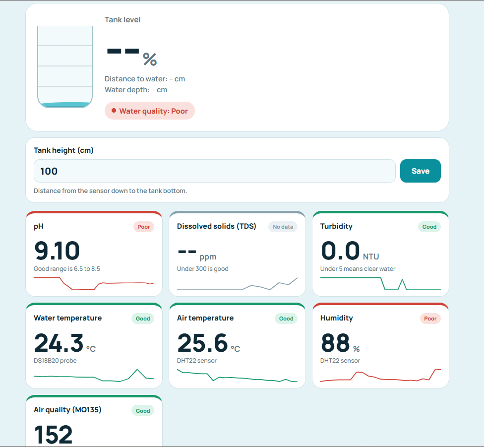
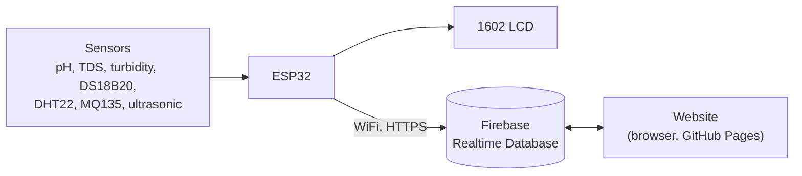
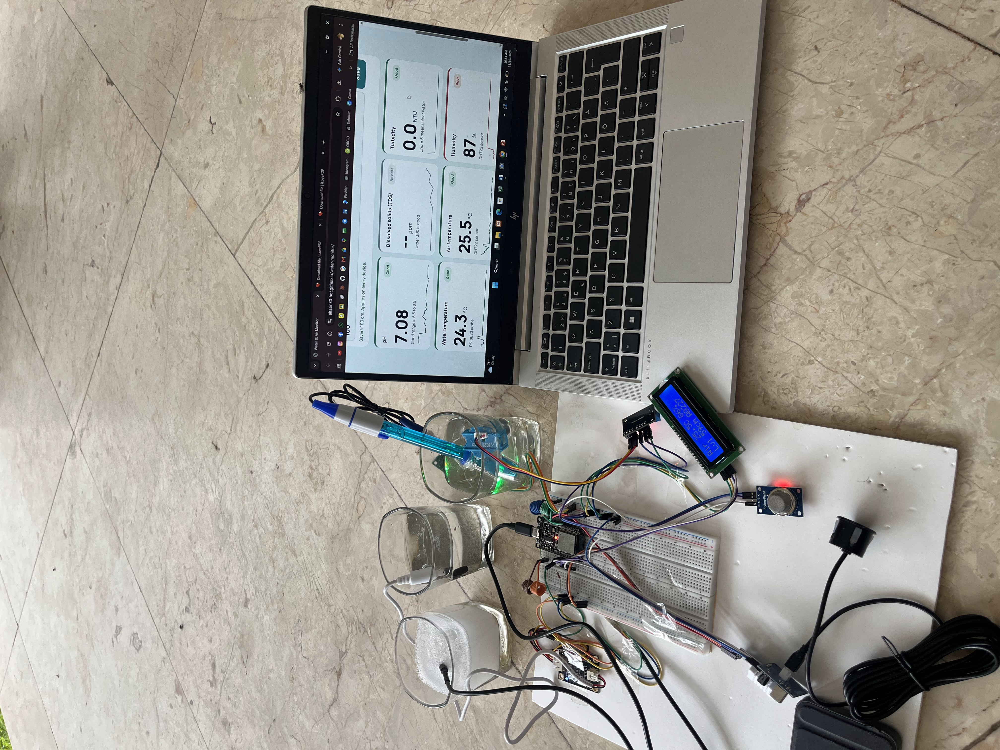

# Water & Air Monitor

An IoT-based **water and air quality monitoring system** built with an **ESP32**, **Firebase Realtime Database** and a responsive web dashboard.

The ESP32 reads water and air sensors, sends the data to Firebase over WiFi every 2 seconds, and a website that can be opened from any phone or PC shows the readings live with quality ratings.

**Live demo:** https://altasin30-bot.github.io/water-monitor/



---

## Features

- Live readings of **pH**, **TDS**, **turbidity**, **water temperature**, **air temperature**, **humidity** and **air quality**
- **Tank level** shown as a filling tank, calculated from an ultrasonic sensor
- **Tank height can be set from the website** and is saved in Firebase, so it applies on every device
- Each reading gets a **Good / Moderate / Poor** rating, plus an overall water quality status
- Small trend chart on every sensor card
- **Online / offline detection:** the dashboard shows "Device offline" if no data arrives for 90 seconds
- A sensor with no signal shows **No data** instead of a wrong value
- **1602 LCD** on the device shows the main readings
- History record saved to the database every 5 minutes
- Responsive light-theme dashboard, works on mobile

---

## System architecture



The website and the ESP32 never talk directly. The ESP32 writes to the database and the website listens to the same paths.

---

## Hardware

| Component | Used for |
|---|---|
| ESP32 Dev Module | Reads sensors and sends data over WiFi |
| Analog pH sensor kit (BNC probe) | Water pH |
| TDS sensor (SEN0244) | Dissolved solids |
| Turbidity sensor (SEN0189) | Water cloudiness |
| DS18B20 waterproof probe | Water temperature |
| DHT22 | Air temperature and humidity |
| MQ135 | Air quality (relative scale) |
| Ultrasonic sensor | Distance to water, for tank level |
| 1602 LCD with I2C module | Local display |
| 2.2 kOhm resistors (5) | DS18B20 pull-up and two voltage dividers |
| Breadboard, jumper wires, USB power | Assembly |

### Pin connections

| Sensor | Signal pin | Power | Notes |
|---|---|---|---|
| DS18B20 | GPIO4 | 3.3 V | 2.2k pull-up between DATA and 3.3V |
| DHT22 | GPIO27 | 3.3 V | |
| Ultrasonic TRIG | GPIO5 | 5 V | |
| Ultrasonic ECHO | GPIO18 | 5 V | 2.2k + 2.2k voltage divider |
| pH (Po) | GPIO34 | 5 V | Direct |
| TDS (A) | GPIO35 | 3.3 V | Direct |
| Turbidity (A) | GPIO32 | 5 V | 2.2k + 2.2k voltage divider |
| MQ135 (AO) | GPIO33 | 5 V | Direct |
| LCD SDA / SCL | GPIO21 / GPIO22 | 5 V | I2C address 0x27 |

All grounds are connected together.

Voltage divider: sensor signal -> 2.2k -> (ESP32 pin) -> 2.2k -> GND. This halves the 5 V sensor output so it is safe for the ESP32.

> Analog sensors are connected to ADC1 pins only, because ADC2 does not work while WiFi is on.

---

## Project structure

```
water-monitor/
├── README.md
├── index.html              <- dashboard (must stay in the root for GitHub Pages)
├── firmware/
│   └── water_monitor/
│       └── water_monitor.ino
└── images/
    ├── dashboard.png
    └── hardware.jpg
```

---

## Firebase database structure

```
sensors/
  latest/            ph, tds, ntu, wt, at, ah, aq, lvl, ts
history/
  {id}               same fields, one record every 5 minutes
settings/
  tankDepth          tank height in cm (set from the website)
```

| Key | Meaning |
|---|---|
| ph | pH value |
| tds | Dissolved solids, ppm |
| ntu | Turbidity, NTU |
| wt | Water temperature, C |
| at / ah | Air temperature C / humidity % |
| aq | Air quality, relative value |
| lvl | Distance from the sensor to the water, cm |
| ts | Server timestamp |

### Security rules

```json
{
  "rules": {
    ".read": true,
    "sensors": { ".write": true },
    "history": { ".write": true },
    "settings": {
      "tankDepth": {
        ".write": true,
        ".validate": "newData.isNumber() && newData.val() >= 5 && newData.val() <= 1000"
      }
    }
  }
}
```

These rules keep writing limited to the paths the project uses, but anyone who knows the database URL can still read and write them. This is fine for a prototype. For real use, add Firebase Authentication.

---

## Setup guide

### 1. Firebase

1. Create a project at https://console.firebase.google.com
2. **Build -> Realtime Database -> Create database** (choose the Singapore region).
3. Open the **Rules** tab, paste the rules above and **Publish**.
4. Copy the database URL.

### 2. ESP32 firmware

1. Install the **ESP32 board package** in Arduino IDE and choose **Tools -> Board -> ESP32 Dev Module**.
2. Install the libraries: `OneWire`, `DallasTemperature`, `DHT sensor library` (with `Adafruit Unified Sensor`) and `LiquidCrystal I2C`.
3. In `water_monitor.ino`, set your values:

```cpp
const char* WIFI_SSID = "YOUR_WIFI_NAME";
const char* WIFI_PASS = "YOUR_WIFI_PASSWORD";
const char* DB_URL    = "https://YOUR-PROJECT-default-rtdb.REGION.firebasedatabase.app";
```

4. Calibrate the pH sensor: put the probe in a pH 7 buffer, read the stable voltage and set it as `PH7_V`.
5. Upload and open the Serial Monitor at `115200`. You should see `PUT /sensors/latest.json -> 200` every 2 seconds.

> Never commit your real WiFi password to GitHub.

### 3. Website

1. Open `index.html` and set `DB_URL` to the same database URL.
2. Upload it to a GitHub repository (the file must be named `index.html`, in the root).
3. **Settings -> Pages -> Deploy from a branch -> main / (root) -> Save.**
4. Open the link GitHub gives you.
5. Enter your tank height in the **Tank height** box and press **Save**.

---

## How it works

1. The ESP32 reads all sensors, taking the median of several samples for the analog ones.
2. It sends one JSON object to `sensors/latest` every 2 seconds, and a copy to `history` every 5 minutes.
3. The website listens to `sensors/latest` through the Firebase SDK and redraws every time a new value arrives.
4. Tank level percentage = (tank height - distance to water) / tank height.
5. A sensor that sends `null` or has no signal is shown as **No data**.

### Rating ranges used by the dashboard

| Sensor | Good | Moderate | Poor |
|---|---|---|---|
| pH | 6.5 - 8.5 | 6 - 9 | outside |
| TDS (ppm) | 0 - 300 | up to 600 | above |
| Turbidity (NTU) | 0 - 5 | up to 25 | above |
| Water temperature (C) | 5 - 30 | 0 - 38 | outside |
| Air temperature (C) | 10 - 32 | 0 - 40 | outside |
| Humidity (%) | 30 - 60 | 20 - 80 | outside |
| Air quality (raw) | 0 - 1200 | up to 2200 | above |

The overall water quality uses pH, TDS, turbidity and water temperature. These are general guidelines, not fish-specific limits.

---

## Screenshots

| Dashboard | Hardware setup |
|---|---|
|  |  |

---

## Limitations

- Accuracy depends on sensor quality and calibration. The pH value is only approximate until it is calibrated with buffer solutions.
- MQ135 gives a relative air quality value, not exact ppm, and needs time to warm up.
- The system needs power and an internet connection for online monitoring.
- The system only shows readings and ratings. It does not treat the water automatically.
- Database rules are open for prototype use (see Security rules).
- The ratings use general ranges, not ranges for a specific fish species.
- Tested only on the authors' own hardware setup.

---

## Future work

The original project proposal also includes the following, which are not part of this version:

- Machine Learning model to judge water suitability for different fish species
- Fish species selection with recommendations when a value needs attention
- Ammonia and dissolved oxygen sensors
- PHP backend and database for long-term storage

---

## Project info

**Course:** CSE402 Internet of Things Lab
**Submitted to:** Abrar Mahbub Tanim, Lecturer
**University:** University of Information Technology & Sciences (UITS)
**Batch:** 54 | **Section:** 7C

**Authors**

- M A Nabihan Tasin (ID: 0432320005101182)
- Irina Ferdous Choity (ID: 0432320005101170)
- Mowmita Mohona (ID: 0432320005101175)
- Md. Khairul Islam (ID: 0432320005101199)

## License

For academic use only.
